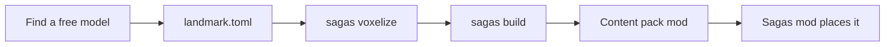

# luanti-sagas

Stories for [Luanti](https://www.luanti.org) worlds, told with real 3D models. A **saga** is a theme,
such as *Vikings*, *dragon fantasy*, *Egypt* or *ruins*. Each saga brings its **landmarks**: castle ruins
on sea cliffs, watchtowers on peaks, temples in the jungle, longships on the shore, halls carved into
the rock. A landmark is a free 3D model (museum scan, photogrammetry, open game art), voxelized into a
schematic and placed by the game where its story fits.

The world stops feeling anonymous when you stumble upon something somebody built.

| | |
|---|---|
|  |  |
|  |  |

The same landmark adapts to the game and the site: the Temple of Amun in
[Minetest Game](docs/screenshots/minetest_game-antiquity-temple_of_amun.jpg) and in
[Mineclonia](docs/screenshots/mineclonia-antiquity-temple_of_amun.jpg).
More in the [gallery](https://culmat.github.io/luanti-sagas/).

## How it works



1. **Find a model**: Sketchfab CC0, museums, 0 A.D. (see [docs/sources.md](docs/sources.md)).
2. **Describe it** in `landmark.toml`: source, licence and hints.
3. **`sagas voxelize`** turns the mesh into coloured voxels, committed as `voxels.vx.gz`.
4. **`sagas build`** maps colours to game material classes or palette colours and adds interior and ruin.
5. **Content pack mod** `mods/sagas_<saga>`: schematics and registry.
6. **The Sagas mod places it** in any game: it picks a site from your hints and builds with local materials.

- **Creators give hints, the mod decides.** A landmark says *"stone watchtower, on coast or river
  cliffs or near waterfalls, built from the stone around it"*:
  `site = ["cliff+coast", "cliff+river", "waterfall"]`, `exposure = "prominent"`,
  `materials.context = "surroundings"`. The mod evaluates that against the terrain while the map
  is generated and builds the tower from desert stone in the desert and deepslate underground.
- **Realistic models use game materials**, so a castle is stone bricks you can mine.
  **Fantasy models keep their colours** (one palette node with 256 colours), so a dragon stays a dragon.
  A value budget keeps gameplay fair: no diamond castles; a few gold eyes are fine.
- **Works in Minetest Game, Mineclonia and VoxeLibre** (headless tests in all three).

## For players

Install **Sagas** from ContentDB (publication pending): one modpack with the `sagas` mod and every saga
(`sagas_ruins`, `sagas_antiquity`, ...), each its own mod, so you can switch off the themes you don't want
in the world's mod settings. Or put the `mods/` folder of this repository into your mods directory.
Settings: rarity, disabled sagas, lore messages (see `mods/sagas/settingtypes.txt`).

With the `sagas` privilege: `/saga list`, `/saga place <id>` (at the node you point at),
`/saga undo`, `/saga here`, `/saga sites <id>` (shows where a landmark would fit), `/saga mark` +
`/saga export <name>` (save a build of your own as a schematic).

## Words we use

| Term | Meaning |
|---|---|
| **saga** | A theme with its own look and story: *ruins*, *antiquity*, *vikings*, *dragon fantasy*. One saga is one content pack mod, `sagas_<saga>`. |
| **landmark** | One structure from one 3D model: a castle, a ship, a statue. Described by `content/<saga>/<landmark>/landmark.toml`. |
| **Sagas** (the mod) | The core mod `sagas`: maps materials to the running game and decides where landmarks go. |
| **hints** | What a creator says about where a landmark belongs and what it is made of. |

More terms (site, exposure, material class, palette, value budget) are in [docs/glossary.md](docs/glossary.md).

## For creators: add a landmark from your browser

No install, no git, no code: fill in the [Add a landmark](https://github.com/culmat/luanti-sagas/issues/new?template=model-found.yml)
form with a link to a free 3D model and where it belongs, in your own words. A bot builds it and shows
you pictures, you adjust it with comments like `/size 24`, a maintainer approves, and it reaches
ContentDB by itself, credited to you. See [CONTRIBUTING.md](CONTRIBUTING.md); for the tools on your
computer, building in the game or working with a coding agent, see
[docs/contributing-with-tools.md](docs/contributing-with-tools.md).

Looking for models? [docs/sources.md](docs/sources.md) lists where free, realistic models are
(museums, Sketchfab CC0/CC-BY scans, 0 A.D. and Millennium A.D. art) and what to avoid.

## Repository

| Path | What |
|---|---|
| `tools/` | Python pipeline, CLI `sagas` (voxelize, build, preview, view, lint, scout) |
| `content/<saga>/<id>/` | One landmark: `landmark.toml` (source of truth), `voxels.vx.gz`, `preview.png` |
| `mods/sagas/` | The core mod: material mapping, site evaluation, placement, commands |
| `mods/sagas_<saga>/` | Generated content packs (schematics + registry + licences) |
| `docs/` | Pipeline, placement and material guides, sources, gallery |

```sh
cd tools && uv sync            # Python 3.12+, no Blender needed
uv run sagas build all         # rebuild every pack from content/
uv run sagas lint              # licences, attribution, size and value checks
avanti test mods               # Luanti headless tests (https://github.com/culmat/avanti-luanti)
```

Maintainers release with a tag; see [docs/releasing.md](docs/releasing.md).

## Working with a coding agent

The repository is set up for coding agents, not one particular product. [AGENTS.md](AGENTS.md) holds the
project notes every agent should read, and [docs/authoring-landmarks.md](docs/authoring-landmarks.md)
is the step-by-step guide an agent follows to turn a model and a creator's words into a landmark.
Agents that support skills pick it up from `.claude/skills/` (Claude Code today); others read the guide.

## Licence

Code: MIT. Each landmark keeps its source model's free licence; packs list every source in
`LICENSE` and `ATTRIBUTION.md`. AI assistance is disclosed (see [LICENSE](LICENSE)).
