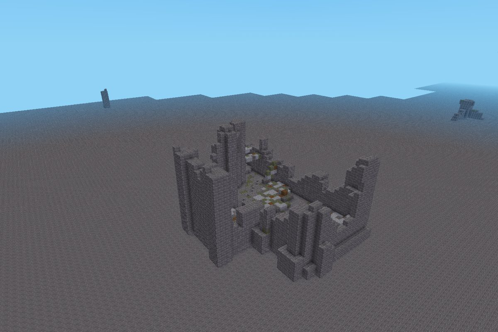
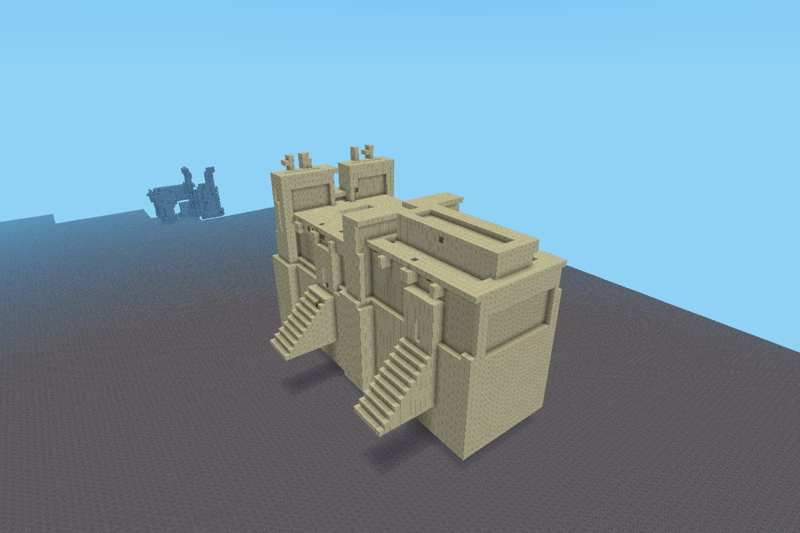
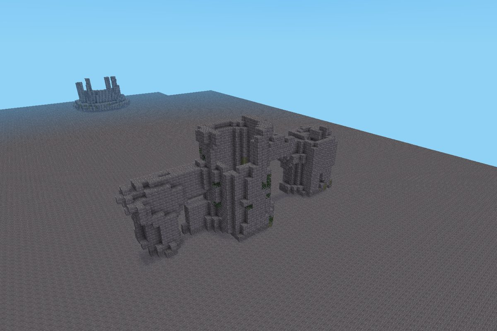
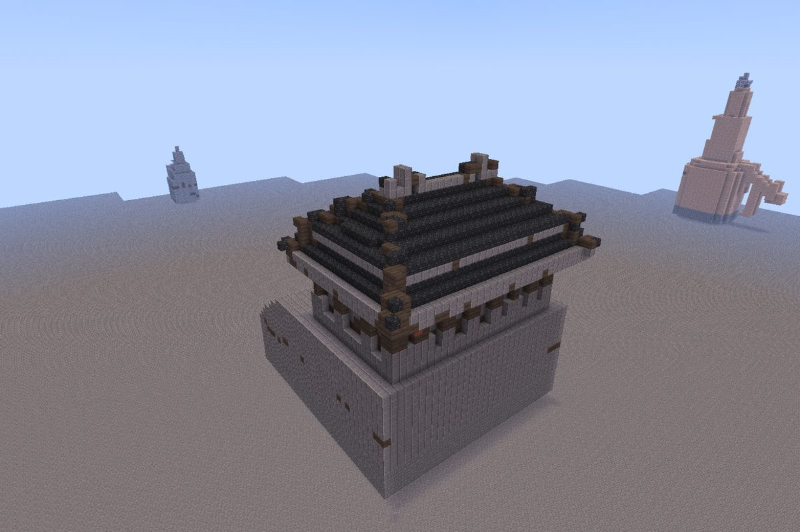

# luanti-sagas

Landmarks from real 3D models for [Luanti](https://www.luanti.org): castle ruins on sea cliffs,
watchtowers on peaks, temples in the jungle, longships on the shore, halls carved into the rock.
Each one is a **saga**: a free 3D model (museum scans, photogrammetry, open game art), voxelized
into a schematic and placed by the game where its story fits.

The world stops feeling anonymous when you stumble upon something somebody built.

| | |
|---|---|
|  |  |
|  |  |

The same saga adapts to the game and the site: the Temple of Amun in
[Minetest Game](docs/screenshots/minetest_game-antiquity-temple_of_amun.jpg) and in
[Mineclonia](docs/screenshots/mineclonia-antiquity-temple_of_amun.jpg).
More in the [gallery](https://culmat.github.io/luanti-sagas/).

## How it works

```
 find a model ──> saga.toml ──> sagas voxelize ──> sagas build ──> content pack mod ──> the sagas mod places it
 (Sketchfab CC0,   (source,      (mesh -> coloured   (classes or     (mods/sagas_<theme>:   (in any game: picks a
  museums, 0 A.D.)  licence,      voxels, committed   palette colours, schematics + registry)  site from your hints and
                    hints)        as voxels.vx.gz)    interior, ruin)                          uses local materials)
```

- **Creators give hints, the mod decides.** A saga says *"stone watchtower, on coast or river
  cliffs or near waterfalls, built from the stone around it"*:
  `site = ["cliff+coast", "cliff+river", "waterfall"]`, `exposure = "prominent"`,
  `materials.context = "surroundings"`. The mod evaluates that against the terrain while the map
  is generated and builds the tower from desert stone in the desert and deepslate underground.
- **Realistic models use game materials**, so a castle is stone bricks you can mine.
  **Fantasy models keep their colours** (one palette node with 256 colours), so a dragon stays a dragon.
  A value budget keeps gameplay fair: no diamond castles; a few gold eyes are fine.
- **Works in Minetest Game, Mineclonia and VoxeLibre** (headless tests in all three).

## For players

Install **Sagas** and one or more packs (`sagas_ruins`, `sagas_antiquity`, ...) from ContentDB
(publication pending), or put the `mods/` folder of this repository into your mods directory as the
`sagas_pack` modpack. Settings: rarity, disabled themes, lore messages (see `mods/sagas/settingtypes.txt`).

With the `sagas` privilege: `/saga list`, `/saga place <id>` (at the node you point at),
`/saga undo`, `/saga here`, `/saga sites <id>` (shows where a saga would fit), `/saga mark` +
`/saga export <name>` (save a build of your own as a schematic).

## For creators: add a saga in 15 minutes

See [CONTRIBUTING.md](CONTRIBUTING.md). Four ways in:

1. **Link a model**: a CC0 / CC-BY / CC-BY-SA model plus a `saga.toml`. Most contributions.
2. **Build in game** and export it with `/saga export`.
3. **No install**: voxelize in the browser (MagicaVoxel, drububu.com) and commit the `.vox` / `.txt`.
4. **Curate**: better materials, placements, lore for existing sagas.

Looking for models? [docs/sources.md](docs/sources.md) lists where free, realistic models are
(museums, Sketchfab CC0/CC-BY scans, 0 A.D. and Millennium A.D. art) and what to avoid.

## Repository

| Path | What |
|---|---|
| `tools/` | Python pipeline, CLI `sagas` (voxelize, build, preview, lint, scout) |
| `content/<theme>/<id>/` | One saga: `saga.toml` (source of truth), `voxels.vx.gz`, `preview.png` |
| `mods/sagas/` | The core mod: material mapping, site evaluation, placement, commands |
| `mods/sagas_<theme>/` | Generated content packs (schematics + registry + licences) |
| `docs/` | Pipeline, placement and material guides, sources, gallery |

```sh
cd tools && uv sync            # Python 3.12+, no Blender needed
uv run sagas build all         # rebuild every pack from content/
uv run sagas lint              # licences, attribution, size and value checks
avanti test mods               # Luanti headless tests (https://github.com/culmat/avanti-luanti)
```

Maintainers release with a tag; see [docs/releasing.md](docs/releasing.md).

## Licence

Code: MIT. Each saga keeps its source model's free licence; packs list every source in
`LICENSE` and `ATTRIBUTION.md`. AI assistance is disclosed (see [LICENSE](LICENSE)).
