# Sagas gallery

Generated by `sagas catalog`. Each card links the source and its licence.

## Sagas: Antiquity

Buildings of the ancient world from the 0 A.D. game art (Wildfire Games, CC-BY-SA 3.0): an Alexandrian lighthouse, Kushite pyramids and the temple of Amun, a Ptolemaic temple, a Greek temple, a Han temple and Briton roundhouses.

### Temple on the hill (`sagas_antiquity:greek_temple`)

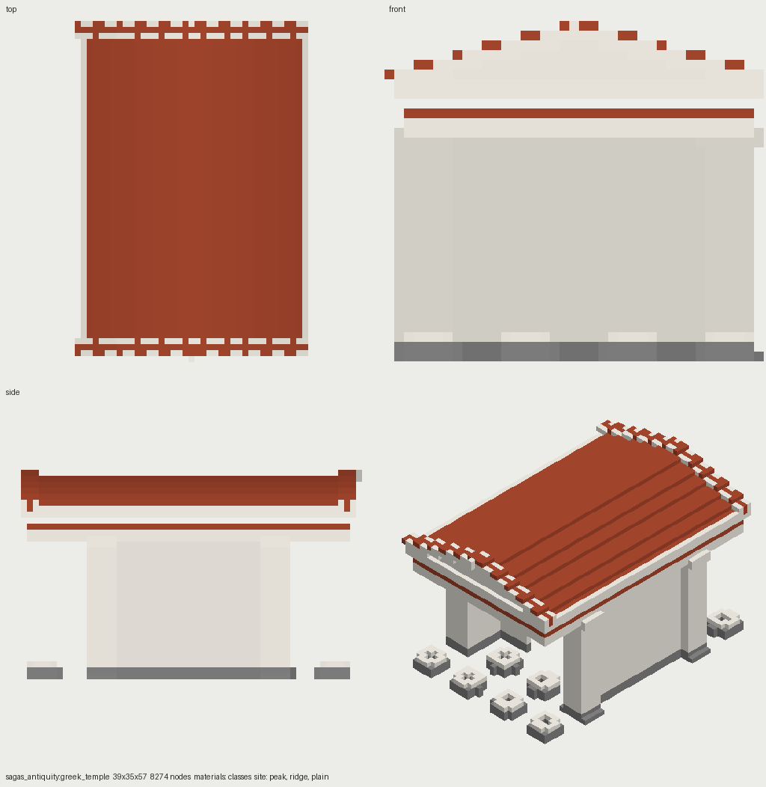

- Size: 39 x 35 x 57 nodes, 8274 nodes, materials: classes
- Placement: peak or ridge or plain; exposure prominent; biomes grassland, savanna, mountain, forest; about one per 1300 mapchunks
- Source: [Wildfire Games (0 A.D.)](https://raw.githubusercontent.com/0ad/0ad/61a3b9507d974084e6badb88a0826bd89a6d5b8b/binaries/data/mods/public/art/meshes/structural/athen_temple_struct.dae), CC-BY-SA-3.0

### Temple of the Han (`sagas_antiquity:han_temple`)

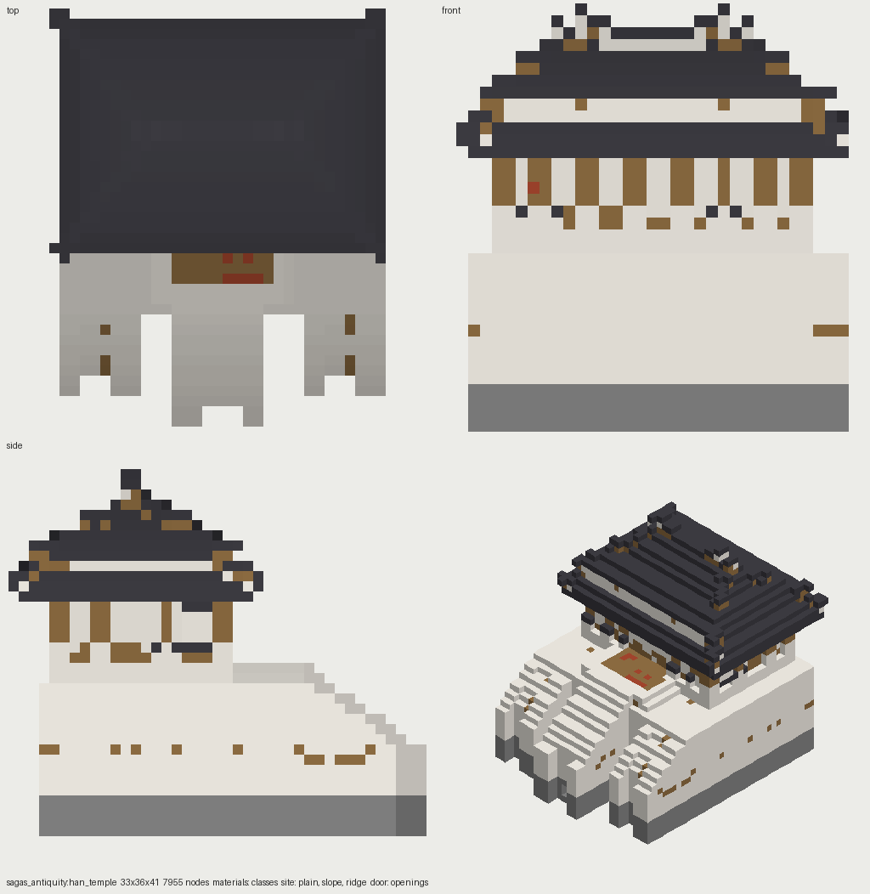

- Size: 33 x 36 x 41 nodes, 7955 nodes, materials: classes
- Placement: plain or slope or ridge; exposure any; biomes forest, jungle, mountain, taiga, grassland; about one per 1300 mapchunks
- Source: [Wildfire Games (0 A.D.)](https://raw.githubusercontent.com/0ad/0ad/61a3b9507d974084e6badb88a0826bd89a6d5b8b/binaries/data/mods/public/art/meshes/structural/han_temple.dae), CC-BY-SA-3.0

### Lighthouse of the harbour (`sagas_antiquity:lighthouse`)

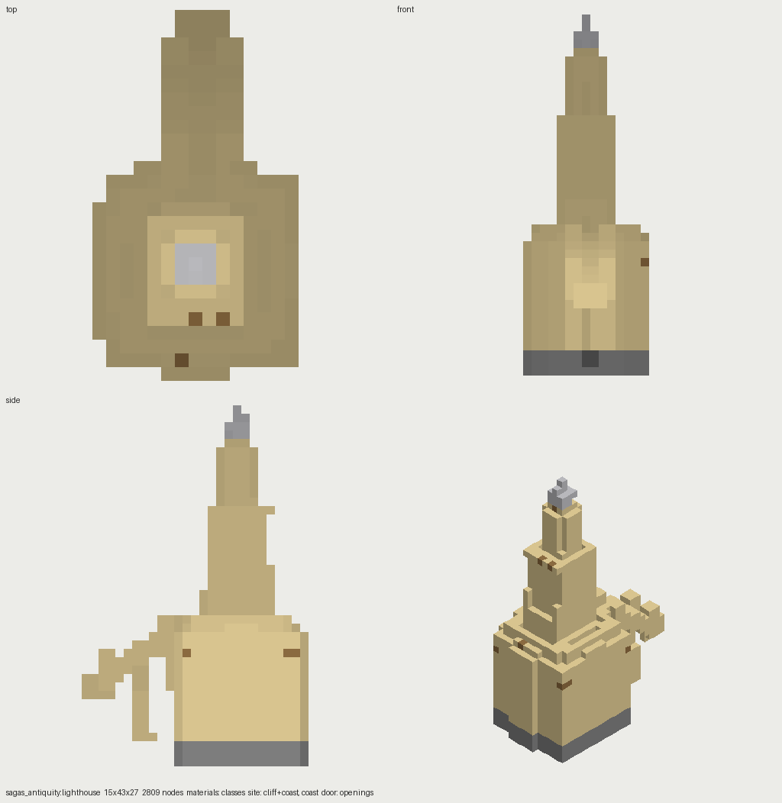

- Size: 15 x 43 x 27 nodes, 2809 nodes, materials: classes
- Placement: cliff+coast or coast; exposure prominent; biomes desert, savanna, grassland, beach; about one per 1500 mapchunks
- Source: [Wildfire Games (0 A.D.)](https://raw.githubusercontent.com/0ad/0ad/61a3b9507d974084e6badb88a0826bd89a6d5b8b/binaries/data/mods/public/art/meshes/structural/ptol_lighthouse.dae), CC-BY-SA-3.0

### Temple by the river (`sagas_antiquity:ptolemaic_temple`)

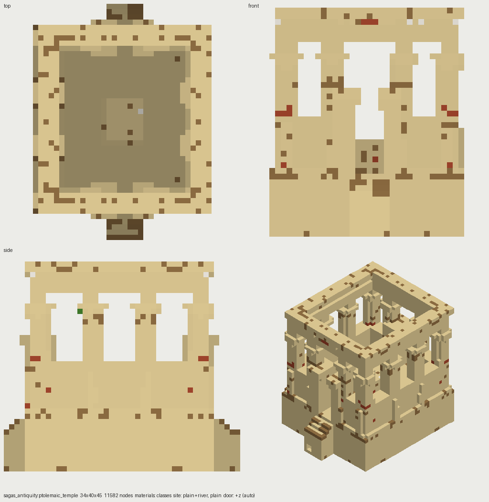

- Size: 34 x 40 x 45 nodes, 11582 nodes, materials: classes
- Placement: plain+river or plain; exposure any; biomes desert, savanna; about one per 1600 mapchunks
- Source: [Wildfire Games (0 A.D.)](https://raw.githubusercontent.com/0ad/0ad/61a3b9507d974084e6badb88a0826bd89a6d5b8b/binaries/data/mods/public/art/meshes/structural/ptol_temple.dae), CC-BY-SA-3.0

### Pyramid of Meroe (`sagas_antiquity:pyramid`)

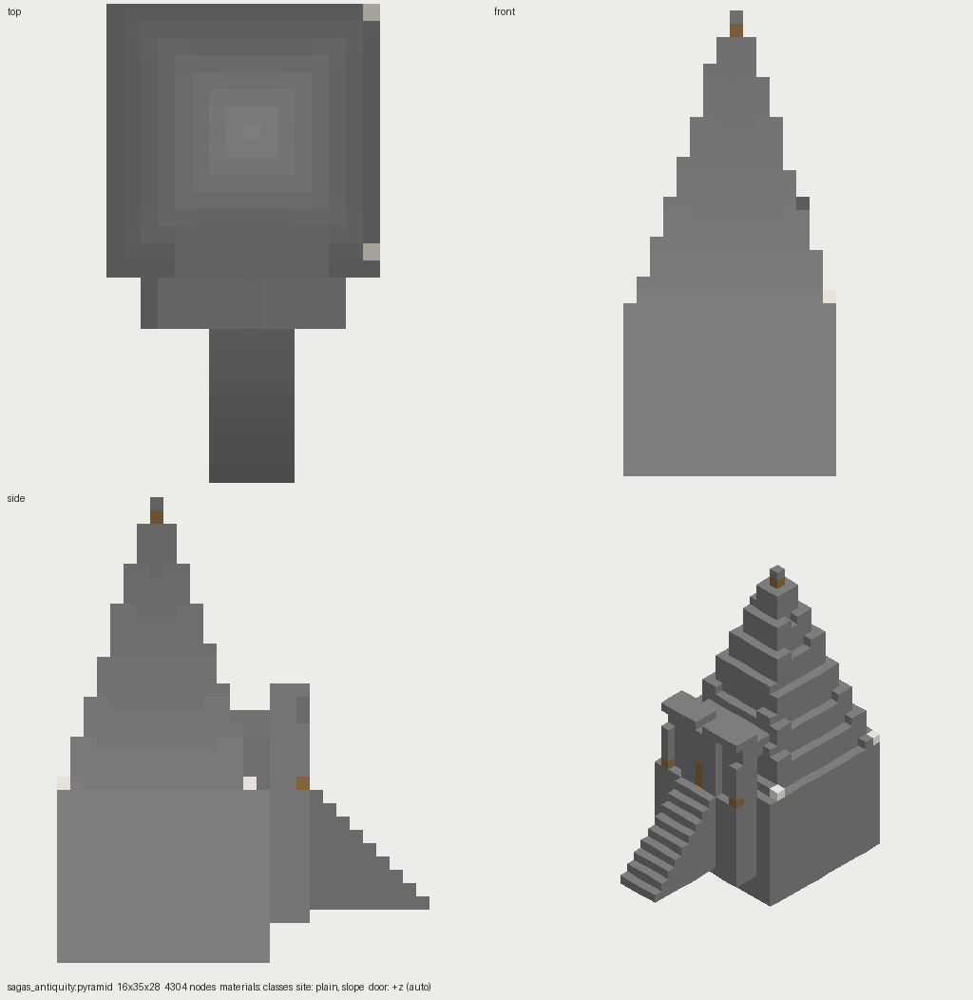

- Size: 16 x 35 x 28 nodes, 4304 nodes, materials: classes
- Placement: plain or slope; exposure any; biomes desert, savanna; about one per 900 mapchunks
- Source: [Wildfire Games (0 A.D.)](https://raw.githubusercontent.com/0ad/0ad/61a3b9507d974084e6badb88a0826bd89a6d5b8b/binaries/data/mods/public/art/meshes/structural/kush_pyramid_1.dae), CC-BY-SA-3.0

### Small pyramid (`sagas_antiquity:pyramid_small`)

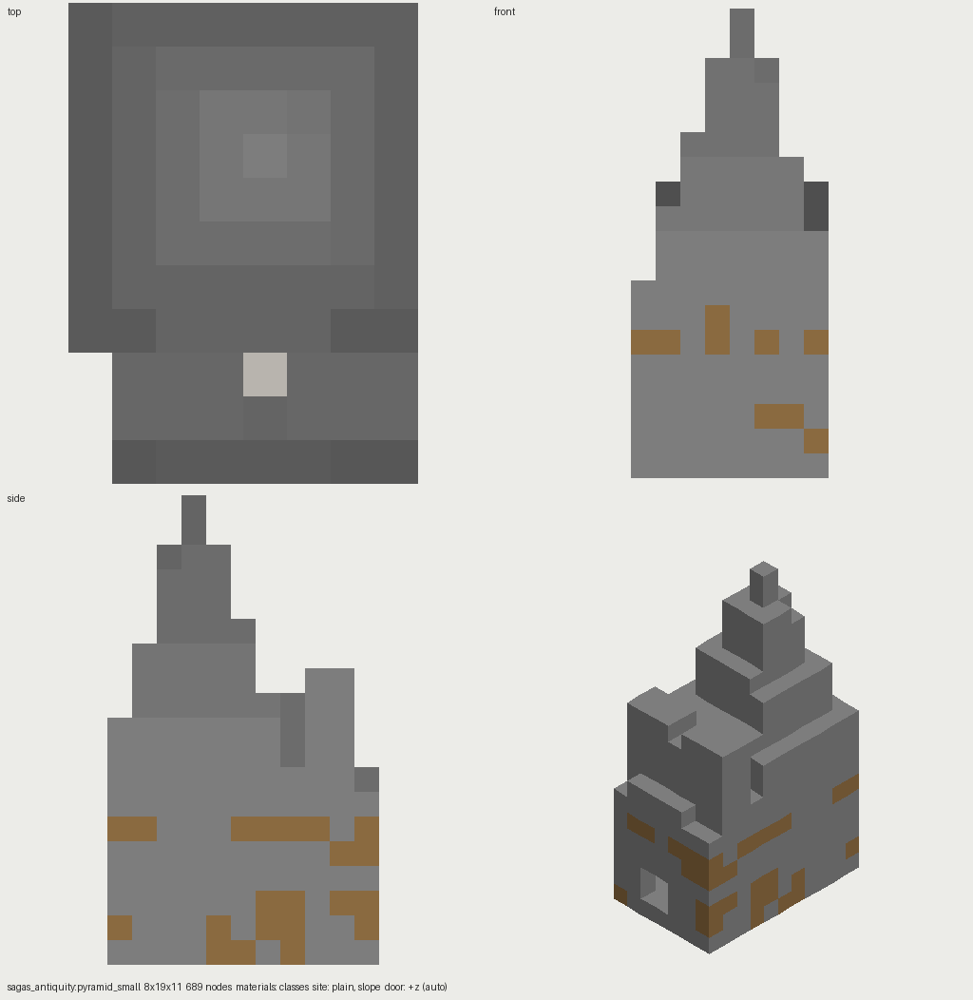

- Size: 8 x 19 x 11 nodes, 689 nodes, materials: classes
- Placement: plain or slope; exposure any; biomes desert, savanna; about one per 350 mapchunks
- Source: [Wildfire Games (0 A.D.)](https://raw.githubusercontent.com/0ad/0ad/61a3b9507d974084e6badb88a0826bd89a6d5b8b/binaries/data/mods/public/art/meshes/structural/kush_pyramid_small_1.dae), CC-BY-SA-3.0

### Roundhouse (`sagas_antiquity:roundhouse`)

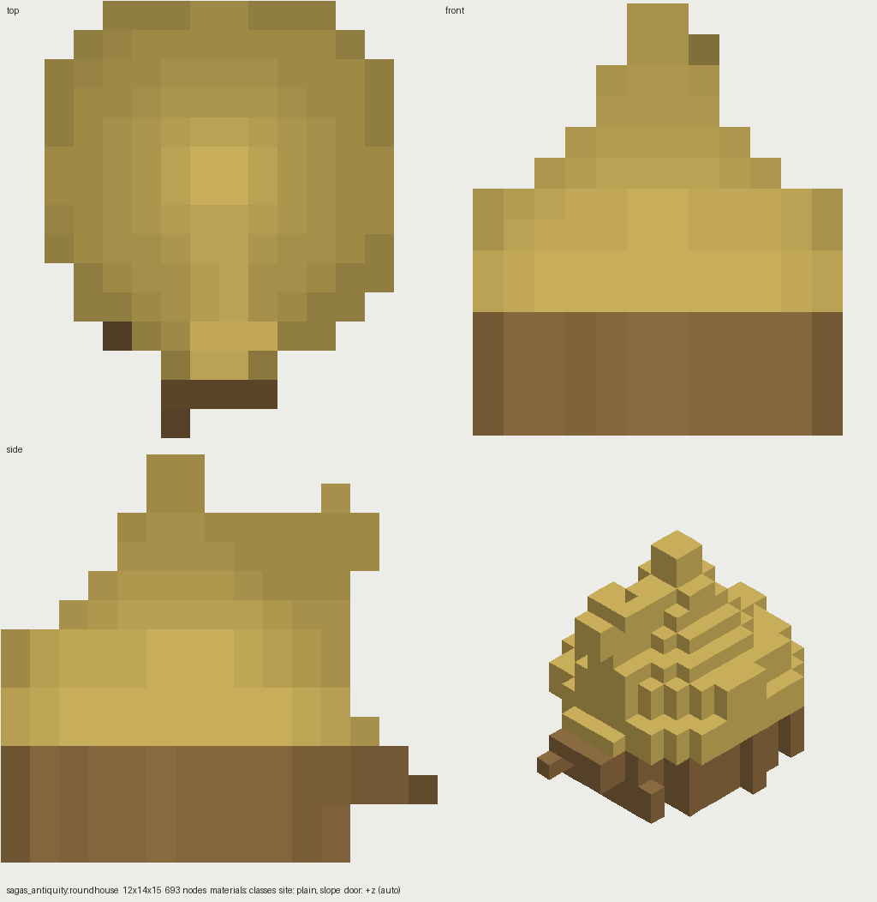

- Size: 12 x 14 x 15 nodes, 693 nodes, materials: classes
- Placement: plain or slope; exposure any; biomes grassland, forest, taiga; about one per 220 mapchunks
- Source: [Wildfire Games (0 A.D.)](https://raw.githubusercontent.com/0ad/0ad/61a3b9507d974084e6badb88a0826bd89a6d5b8b/binaries/data/mods/public/art/meshes/structural/brit_house_01.dae), CC-BY-SA-3.0

### Temple of Amun (`sagas_antiquity:temple_of_amun`)

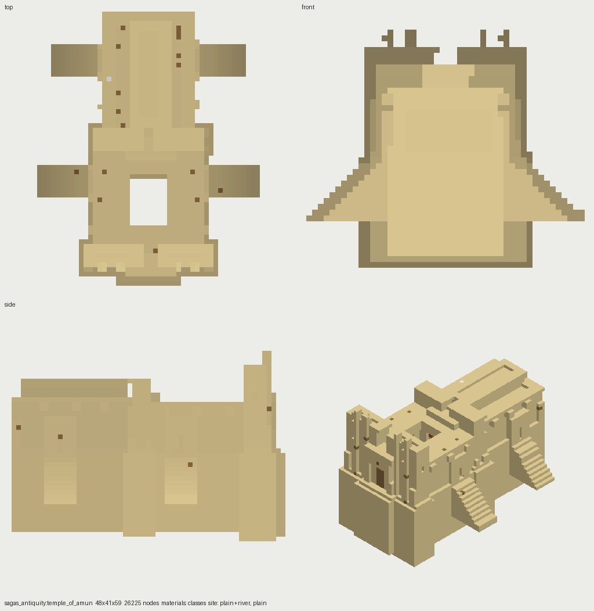

- Size: 48 x 41 x 59 nodes, 26225 nodes, materials: classes
- Placement: plain+river or plain; exposure any; biomes desert, savanna; about one per 2500 mapchunks
- Source: [Wildfire Games (0 A.D.)](https://raw.githubusercontent.com/0ad/0ad/61a3b9507d974084e6badb88a0826bd89a6d5b8b/binaries/data/mods/public/art/meshes/structural/kush_temple_amun.dae), CC-BY-SA-3.0

## Sagas: Ruins

Ruined temples, a cathedral, arches and stone circles from the CC0 3TD Fantasy Ruins Pack, the gates of Menlo Castle (Co. Galway, photogrammetry) and a mammoth skeleton from the Smithsonian.

### Ruined cathedral (`sagas_ruins:cathedral`)

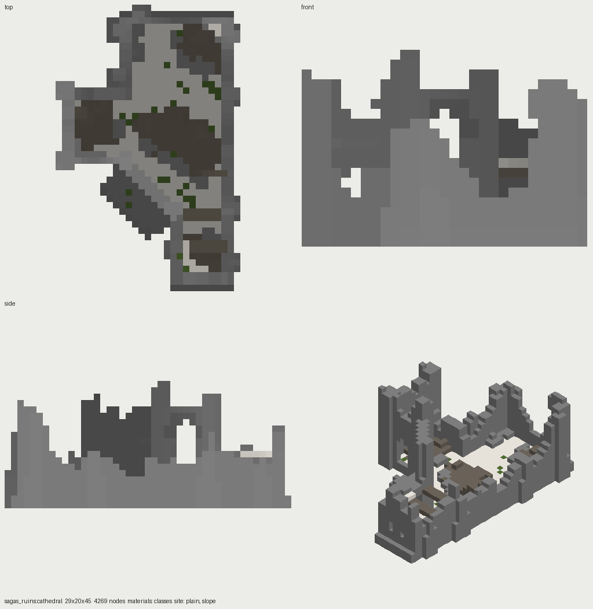

- Size: 29 x 20 x 45 nodes, 4269 nodes, materials: classes
- Placement: plain or slope; exposure any; biomes grassland, forest, taiga, mountain; about one per 2500 mapchunks
- Source: [Ron Kapaun / 3TD Studios](https://opengameart.org/sites/default/files/Fantasy%20Ruins%20Pack.zip), CC0-1.0

### Old foundation (`sagas_ruins:foundation_ruin`)

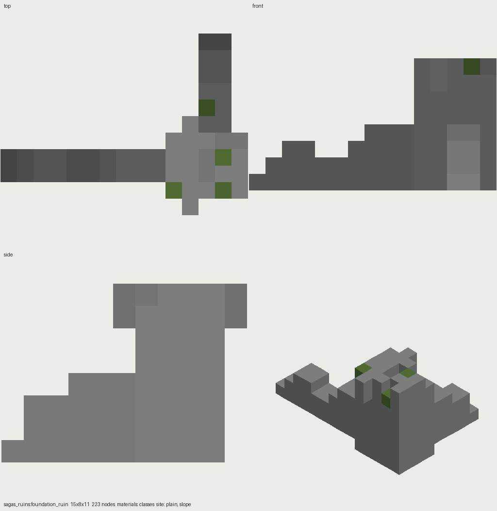

- Size: 15 x 8 x 11 nodes, 223 nodes, materials: classes
- Placement: plain or slope; exposure any; biomes grassland, forest, taiga, savanna; about one per 160 mapchunks
- Source: [Ron Kapaun / 3TD Studios](https://opengameart.org/sites/default/files/Fantasy%20Ruins%20Pack.zip), CC0-1.0

### Mammoth skeleton (`sagas_ruins:mammoth_skeleton`)

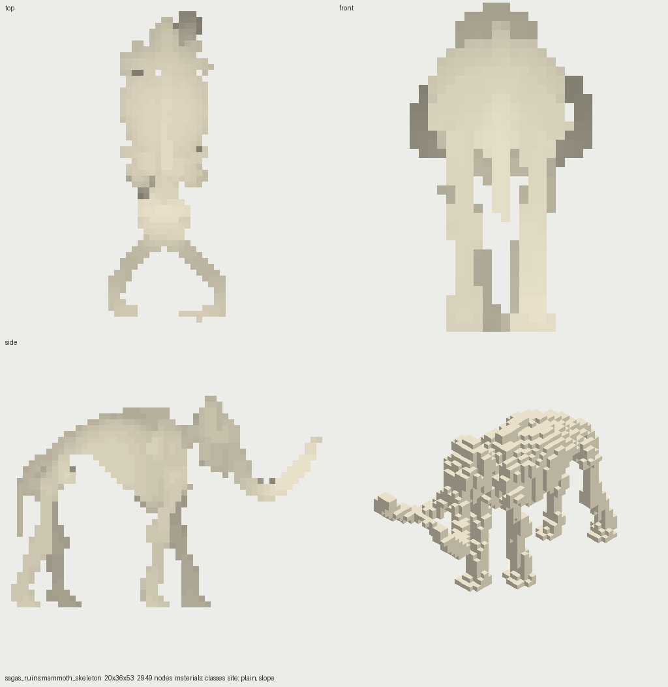

- Size: 20 x 36 x 53 nodes, 2949 nodes, materials: classes
- Placement: plain or slope; exposure any; biomes tundra, snow, taiga; about one per 1500 mapchunks
- Source: [Smithsonian Institution](https://sketchfab.com/3d-models/mammuthus-primigenius-blumbach-229976b3db4646b39c44e57a7e3d8744), CC0-1.0

### Gates of Menlo Castle (`sagas_ruins:menlo_gate`)

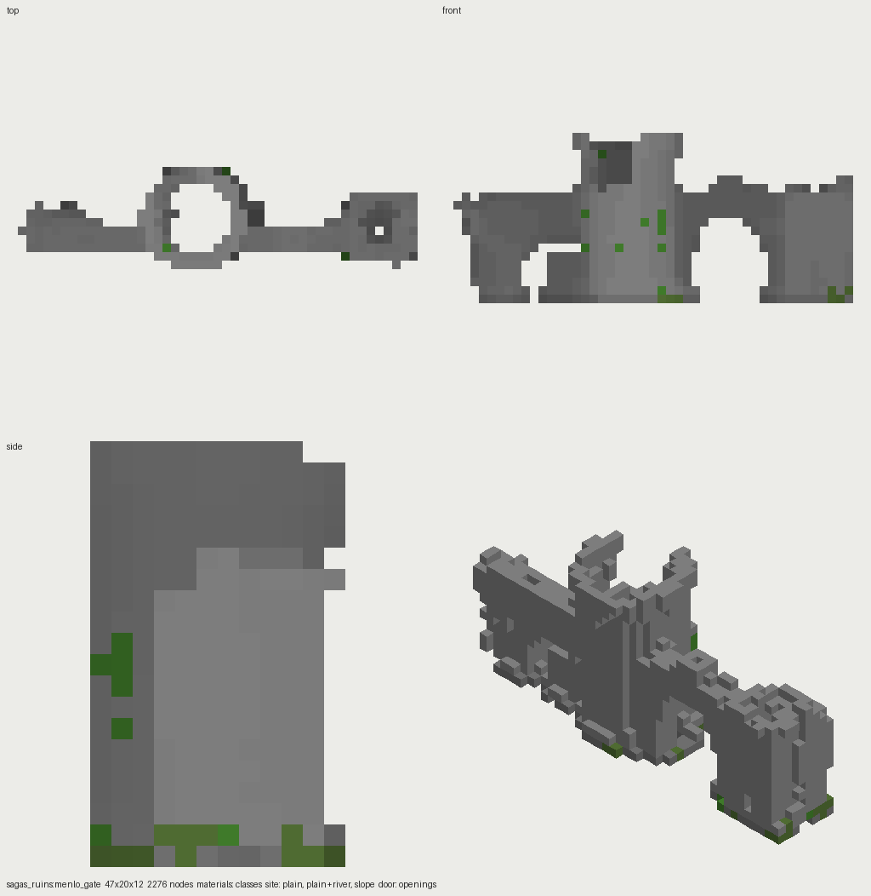

- Size: 47 x 20 x 12 nodes, 2276 nodes, materials: classes
- Placement: plain or plain+river or slope; exposure any; biomes grassland, forest, swamp; about one per 900 mapchunks
- Source: [galway3d](https://sketchfab.com/3d-models/entrance-gates-to-menlo-castle-co-galway-03786e366204470c92655c2889a93ee6), CC0-1.0

### Broken aqueduct arch (`sagas_ruins:ruin_arch`)

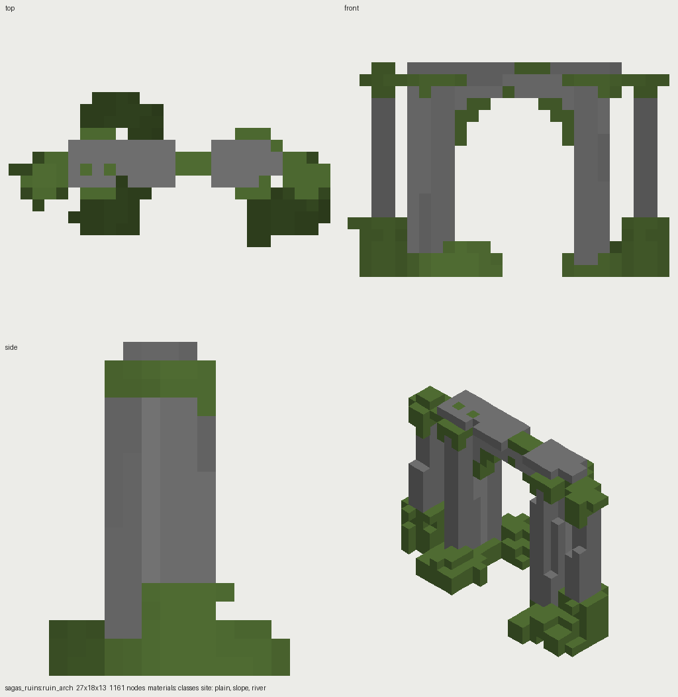

- Size: 27 x 18 x 13 nodes, 1161 nodes, materials: classes
- Placement: plain or slope or river; exposure any; biomes grassland, savanna, desert, forest; about one per 450 mapchunks
- Source: [Ron Kapaun / 3TD Studios](https://opengameart.org/sites/default/files/Fantasy%20Ruins%20Pack.zip), CC0-1.0

### Speaking stones (`sagas_ruins:speaking_stones`)

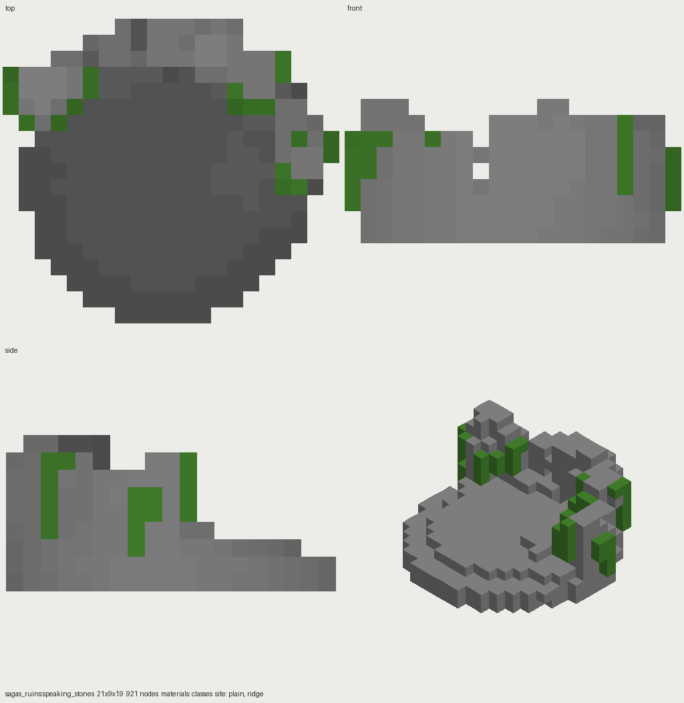

- Size: 21 x 9 x 19 nodes, 921 nodes, materials: classes
- Placement: plain or ridge; exposure prominent; biomes grassland, tundra, taiga, snow, mountain; about one per 600 mapchunks
- Source: [Ron Kapaun / 3TD Studios](https://opengameart.org/sites/default/files/Fantasy%20Ruins%20Pack.zip), CC0-1.0

### Overgrown temple (`sagas_ruins:temple_ruin_01`)

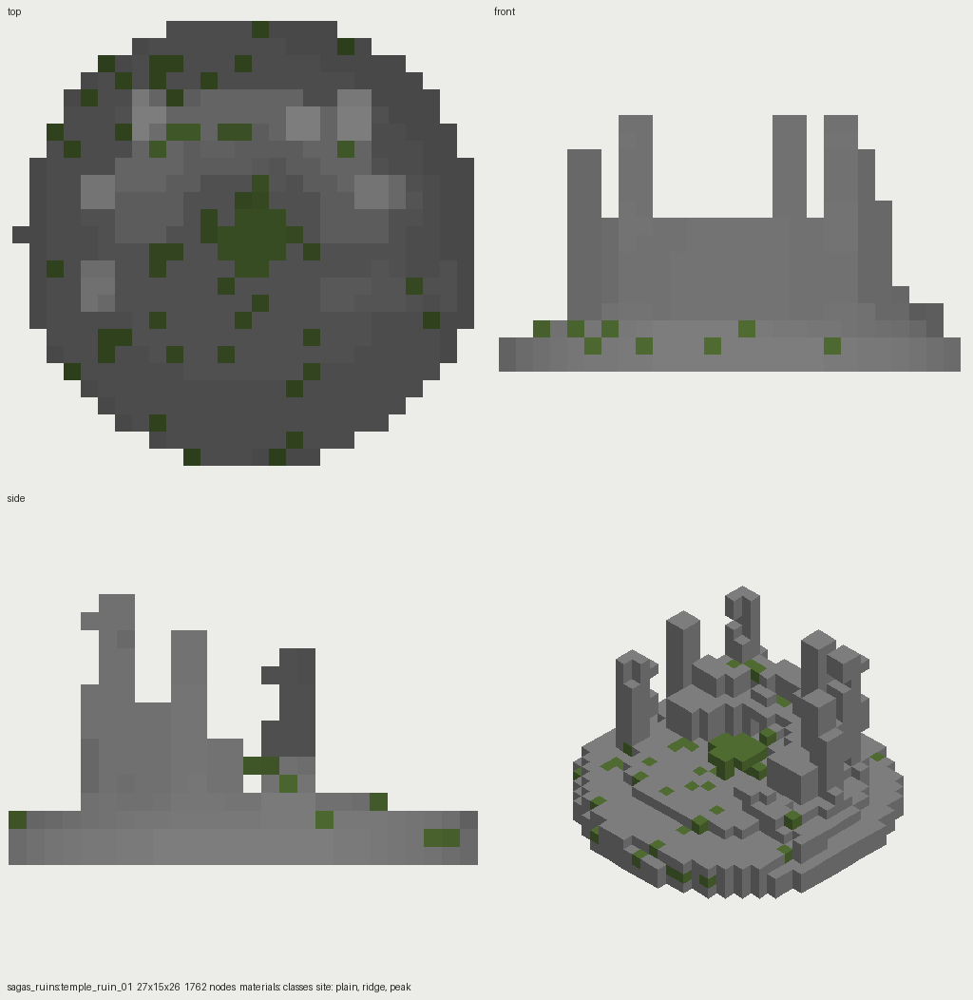

- Size: 27 x 15 x 26 nodes, 1762 nodes, materials: classes
- Placement: plain or ridge or peak; exposure any; biomes forest, jungle, grassland, savanna; about one per 700 mapchunks
- Source: [Ron Kapaun / 3TD Studios](https://opengameart.org/sites/default/files/Fantasy%20Ruins%20Pack.zip), CC0-1.0

### Temple of the four arches (`sagas_ruins:temple_ruin_02`)

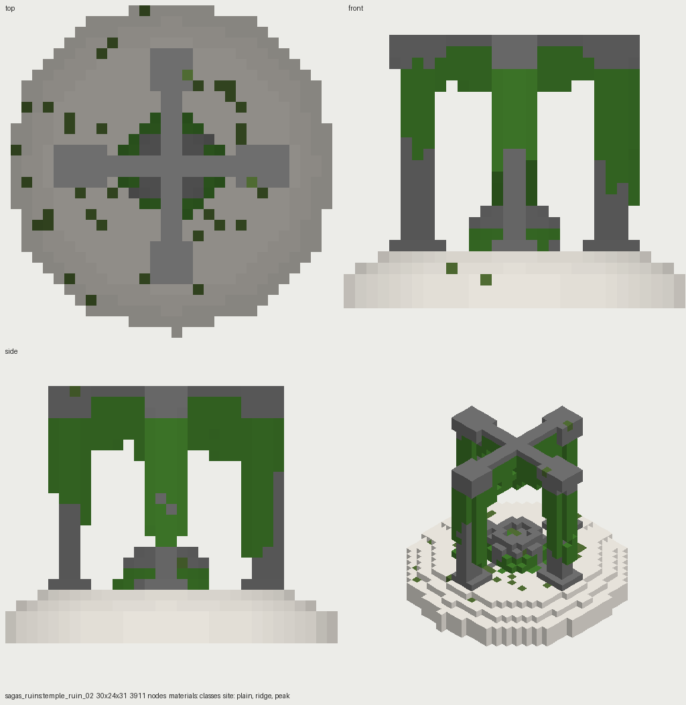

- Size: 30 x 24 x 31 nodes, 3911 nodes, materials: classes
- Placement: plain or ridge or peak; exposure prominent; biomes forest, jungle, grassland, savanna, mountain; about one per 700 mapchunks
- Source: [Ron Kapaun / 3TD Studios](https://opengameart.org/sites/default/files/Fantasy%20Ruins%20Pack.zip), CC0-1.0

### Ruined wall (`sagas_ruins:wall_segment`)

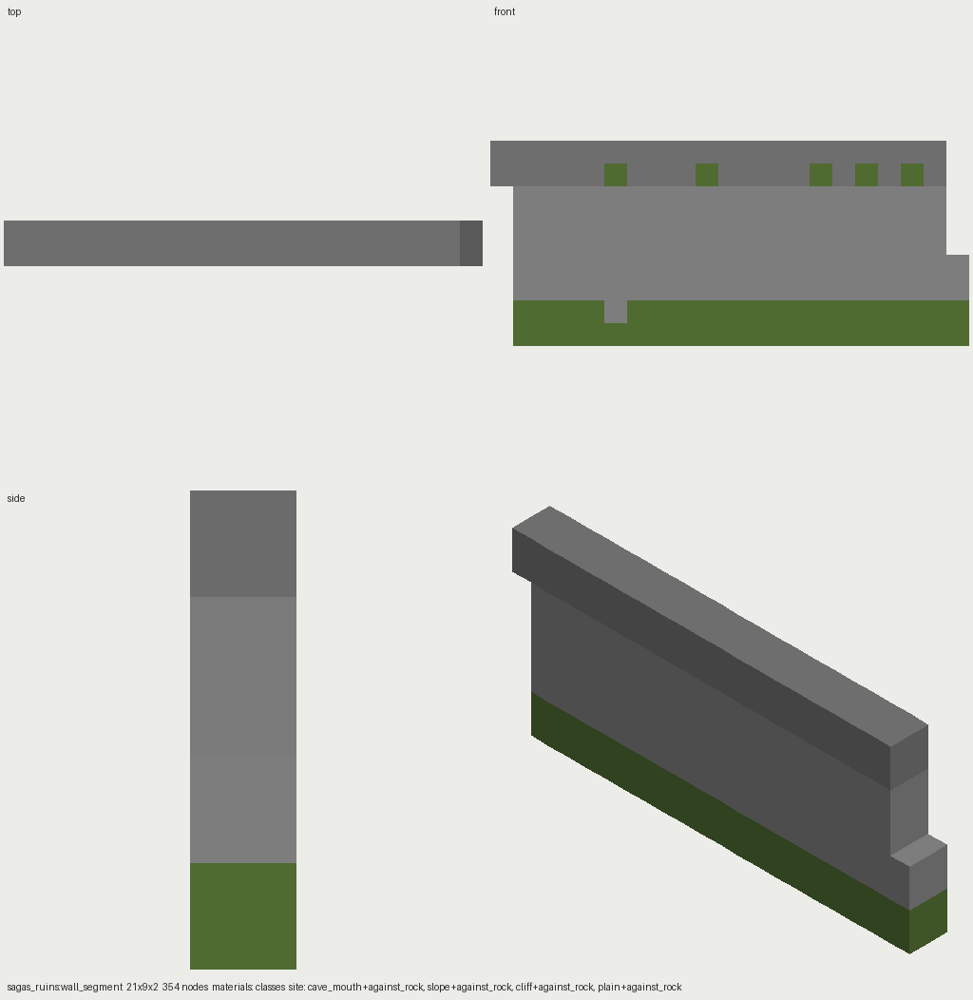

- Size: 21 x 9 x 2 nodes, 354 nodes, materials: classes
- Placement: cave_mouth+against_rock or slope+against_rock or cliff+against_rock or plain+against_rock; exposure any; biomes grassland, forest, taiga; about one per 140 mapchunks
- Source: [Ron Kapaun / 3TD Studios](https://opengameart.org/sites/default/files/Fantasy%20Ruins%20Pack.zip), CC0-1.0
